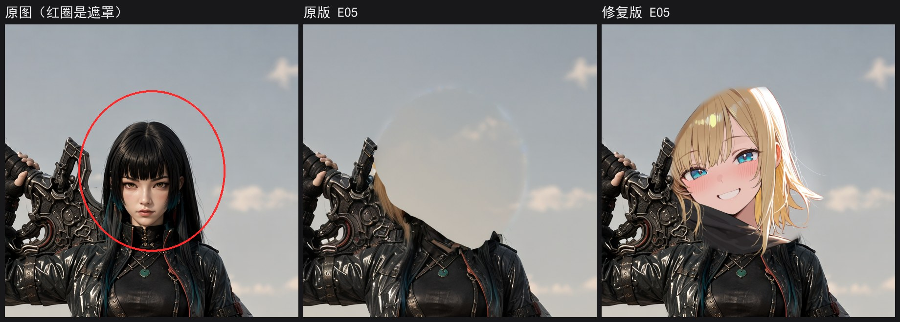

# E05 局部重绘（SDXL）修复说明（2026-10-03）

修复版已经覆盖服务器上的文件：`/root/ComfyUI/user/default/workflows/E图像-SDXL-IL/E05-局部重绘-手绘遮罩SDXL.json`

原版备份在 `/root/workflow-backups/E05-局部重绘-手绘遮罩SDXL.orig-20261003.json`。想换回原版：

```bash
ssh autodl-4080 'cp "/root/workflow-backups/E05-局部重绘-手绘遮罩SDXL.orig-20261003.json" "/root/ComfyUI/user/default/workflows/E图像-SDXL-IL/E05-局部重绘-手绘遮罩SDXL.json"'
```

## 遮罩涂抹区域

原版其实能涂遮罩：「加载图像」节点自带遮罩编辑器。问题是入口藏得太深：

- 唯一的提示写在分组标题里，标题比分组还宽，被截断了，看不到。
- 要右键节点才能打开。右键菜单有 39 项，Open in MaskEditor 排在第 24 项。

你今天跑的两次用的都是原来的 1.png，没涂遮罩，所以图基本没变，两次分别跑了 54 秒和 40 秒。

修复后：

- 底图节点的标题直接写「右键 → Open in MaskEditor 涂遮罩」。
- 旁边加了一个「怎么涂遮罩」说明节点，写了三步操作。
- 分组加宽了，标题不会再被截断。

想在画布上直接涂、不弹窗的话：ComfyUI 自带的 Painter 节点可以，它会把接进来的底图当背景，直接在节点里涂。但它只在新版节点界面（设置里的 Nodes 2.0）下显示。你现在用的是经典界面，在经典界面下它只显示一行「Node 2.0 only」，所以这次没用它。

## 其他问题和改法

| 问题 | 后果 | 改法 |
|---|---|---|
| 用 VAEEncodeForInpaint 编码 | 它会先把涂过的地方填成灰色，只适合专门的重绘模型。waiIllustrious 是普通 SDXL 模型，测试里涂过的地方直接变成一团灰；而且 denoise 只能用 1，没法保留原来的轮廓只改细节 | 换成 ComfyUI 自带的 InpaintModelConditioning，普通模型也能用，denoise 可调 |
| 整张大图直接送进模型 | 1.png 是 2832×2048，约 580 万像素；SDXL 在 100 万像素左右画得最好，大图又慢又容易画崩 | 加 Inpaint Crop 和 Inpaint Stitch 两个节点：只裁出遮罩附近一块，缩放到 1024×1024 重绘，再缩回原尺寸拼回原图 |
| 遮罩外面也被改了 | 整张图过一遍 VAE 编码再解码，遮罩外会轻微变色、变糊；测试里遮罩外 58% 的像素变了 | 只把遮罩附近拼回原图，其他地方保持原图像素 |
| 遮罩边缘是硬边 | 容易留接缝 | 拼回时边缘羽化 32 像素 |
| 保存的文件名多一个下划线 | 前缀写的是 inpaint_，文件名变成 inpaint__00001_.png | 前缀改成 inpaint |

## 测试

同一张图（1.png）、同一个遮罩（站着那个人的头部）、同样的提示词（金色短发、微笑）和种子，原版和修复版各跑了一次：

- 原版：41.3 秒。涂过的地方变成一团灰，没有脸。离遮罩 64 像素以外的区域有 58% 的像素变了，最大差值 220（满值 255）。
- 修复版：11.4 秒。重绘出了新的头部，边缘融进了原图。离遮罩 64 像素以外的区域一个像素都没变。



修复版画出来的是二次元脸，因为 waiIllustrious 本身是二次元模型。底图偏写实时画风会对不上，这是模型决定的，换写实模型才能对上。

## 新加节点的参数

Inpaint Crop 只改了下面几项，其余用插件默认值：

- 输出尺寸 1024×1024：SDXL 的原生尺寸。
- 周边范围 1.5 倍：裁的时候在遮罩外多带一圈画面给模型看，画风和光线才接得上。你的 C14 里用的是 1.2 到 2 倍。
- 遮罩外扩 8 像素：沿用原版的 grow_mask_by 8，涂得不严时也能盖住边缘。
- 用 GPU 计算：和 C14 一样。

KSampler 没动：28 步、cfg 5.5、dpmpp_2m + karras、denoise 1。想保留原来的轮廓、只改细节，可以把 denoise 调到 0.5 到 0.8。

## 打开时注意

- ComfyUI 里如果还开着旧的 E05 标签，先关掉，再从工作流列表重新打开。在旧标签上保存会把修复版覆盖掉。
- 服务器没给工作流文件设缓存规则，浏览器可能还会拿缓存里的旧版。打开后如果看不到「怎么涂遮罩」说明节点，过几分钟再打开。

## 测试用过的东西

测试遮罩图放在 ComfyUI 的临时目录，两张测试输出图和队列里的两条测试记录，测完都删了。ComfyUI 的设置没有改动。
